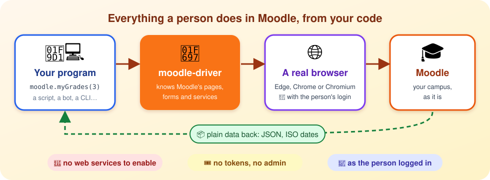
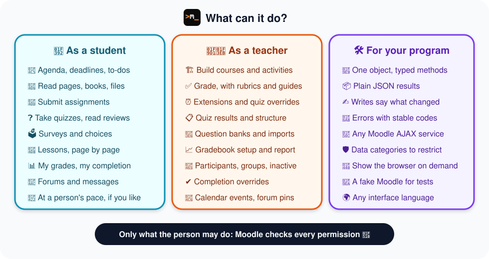

<div align="center">

m_" width="112"/>

# moodle-driver

**Everything a person does in Moodle, from your Node.js code.**<br/>
With their own login: no web services, no tokens, no admin.

[](https://falkenslab.github.io/moodle-driver/)
[](https://github.com/falkenslab/moodle-driver/releases)


[](LICENSE)



</div>

## ✨ In a few lines

```ts
import { createMoodle } from "@falkenslab/moodle-driver";

await using moodle = createMoodle({ site: "https://campus.example.org/", profileDir: "/home/ada/.moodle-profile", headless: true, downloadBrowser: true });
await moodle.logIn(); // 🔑 the first time a window opens and the person logs in; afterwards, nothing

for (const course of await moodle.listCourses()) {
  const { pending } = await moodle.pendingActivities(course.id);
  console.log(`📚 ${course.fullname}: ${pending.length} things to do`);
}
```

That's it: no API keys, nothing to ask the administrator. The browser closes by itself at the end of the block.

## 🧰 What it can do

<div align="center">

</div>

## 🚀 A taste

**🎒 A student's week**, deadlines first:

```ts
for (const d of await moodle.deadlines({ days: 7 })) {
  console.log(`${d.date.slice(0, 10)}  ${d.activity}${d.overdue ? "  ⚠️ overdue" : ""}`);
}
```

**🧑‍🏫 A teacher grading** what's waiting, with feedback the student gets notified of:

```ts
for (const s of await moodle.assignmentSubmissions(35)) {
  if (s.needsGrading) await moodle.gradeSubmission(35, s.userId, { grade: 8.5, feedback: "<p>Great work!</p>", notify: true });
}
```

**🏗️ Building a course**: every write tells you what it did:

```ts
const { changed } = await moodle.createActivity({ courseId: 3, sectionId: 7, type: "page", name: "Loops", content: "<p>for, while…</p>" });
console.log(changed); // Created page 42 "Loops" in section 2.
```

More, complete and commented: [📖 use-case examples](https://falkenslab.github.io/moodle-driver/examples).

## 💡 Why it's different

- 🔑 **The person's own login.** They log in once in a window (SSO and two-factor included); the driver never sees a password.
- 🚫 **No web services.** Many campuses don't enable them. The driver uses the same pages and AJAX services Moodle's own screens use.
- 🔐 **Moodle decides.** It can do what the person can do, and nothing more: every permission is Moodle's.
- 🌍 **Any language.** Pages are read by structure (ids, data attributes, field names), never by their text.
- 🐢 **At a person's pace** when acting as a student, so Moodle's logs and completion look like a person's; or 🐇 fast when time matters.
- 🛡️ **Safe to hand to an agent.** Every function declares the data it touches (own, course content, others' work, communication…), so a program can allow only some.
- 📦 **Plain data, typed.** JSON results, ISO dates, errors with stable codes, TypeScript types included.

## 📦 Install

Not on npm yet: use it from a clone, next to your program.

```bash
git clone https://github.com/falkenslab/moodle-driver.git
cd moodle-driver && npm install && npm run build
```

```json
{ "dependencies": { "@falkenslab/moodle-driver": "file:../moodle-driver", "playwright-core": "^1.64.0" } }
```

You need Node.js 20+, a Moodle 4.x or 5.x site, and Edge or Chrome (or let it download Chromium). See [installation](https://falkenslab.github.io/moodle-driver/getting-started/installation).

## 📚 Documentation

| | |
| --- | --- |
| 🏁 [Getting started](https://falkenslab.github.io/moodle-driver/getting-started/installation) | Install, log in, your first program |
| 💡 [Concepts](https://falkenslab.github.io/moodle-driver/concepts/how-it-works) | How it works, the browser, errors, pace, data categories |
| 🗺️ [Moodle areas](https://falkenslab.github.io/moodle-driver/areas/courses) | Every function, by area: courses, quizzes, grading, forums… |
| 📖 [Examples](https://falkenslab.github.io/moodle-driver/examples) | Complete programs for real tasks, commented |
| 📘 [Glossary](https://falkenslab.github.io/moodle-driver/reference/glossary) | Moodle's terms, explained for programmers |
| 🔎 [API reference](https://falkenslab.github.io/moodle-driver/api) | Generated from the code |

## 🛠️ Development

```bash
npm install
npm run typecheck && npm run lint
npm run test:docker    # the tests open browsers: always in Docker, never on the desktop
npm run build          # dist/, with declarations
npm run docs:check     # every example in the docs compiles against the code
```

The design lives in [`.minispec/`](.minispec/) (start with `core/project.md` and the decisions). Extracted from moodle-mcp, its first consumer.

## 📄 License

MIT © Falkenslab
