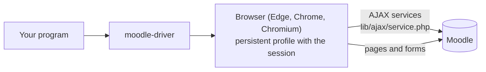

# How it works

The driver does in Moodle what the person's browser does when they use the site: it loads Moodle's pages with their session, and from those pages calls the services Moodle's own JavaScript calls. Knowing how lets you predict what a call costs, what Moodle logs and why it works in any interface language.

**Terms:** [ajax service](../reference/glossary.md#ajax-service), [sesskey](../reference/glossary.md#sesskey), [working tab](../reference/glossary.md#working-tab).

## One browser, many tabs

`createBrowserManager` owns a single persistent browser context on the profile. Functions take that context and, for each piece of work, open a tab, do what they need and close it. The browser starts on the first call and stays open until `close()`. Only one launch or relaunch happens at a time, because two browsers can't share a profile.

## Services first, pages where no service helps

Moodle's pages call AJAX services (`lib/ajax/service.php`) for most of what they show: the course's state, a forum's posts, a grading panel, a table of participants. Those services answer JSON, are stable across themes and languages, and check permissions as the page would. The driver calls them as the page does, with the person's session and its `sesskey`, but without a tab: an HTTP request carrying the profile's cookies (`service.php` needs nothing a browser adds). It reads the `sesskey` once from a light page (the person's preferences) and keeps it; when Moodle says it's stale (a new login, an expired session), it's read again once before giving up with `NotLoggedInError`. Pages and forms open in tabs: measured, reading them without one gains little, because Moodle's server takes most of the time (ADR-011).

Many things have no AJAX service open to the browser, or have one only for the mobile app: submitting an assignment, posting in a forum, a quiz attempt, an activity's settings, a choice. For those the driver loads the page and reads it, or fills and submits the same form the person would, with the same validation and the same messages. Where Moodle renders a form inside the page from a service (dynamic forms, fragments), the driver asks for it, fills it in a blank tab and sends it back serialized, as the page's modal does.

## Read by structure, never by text

Moodle sites run in many languages, and themes change wording. The driver never matches visible texts. It reads:

- ids and data attributes (`data-itemid`, `data-region`, `data-cmid`…),
- form field names (`grade`, `answer`, `advancedgrading[criteria][1][levelid]`…),
- body ids, which name the page in any language (`page-mod-quiz-view`),
- URLs and their parameters (`/mod/assign/view.php?id=35`, `slot=3`),
- icon file names and CSS classes that encode a state (`completion-auto-y`, `qtype_multichoice`, `correct`).

Texts come back as they are, in the site's language (a date as Moodle shows it, a status), only where there's nothing machine-readable.

## What Moodle sees

The driver is the person, in their browser. Moodle logs page views and actions as the person's, completion follows what they view or do, and notifications go out as if they had clicked. That's what makes the driver work without special permissions, and also why a student program has a choice of [pace](student-pace.md): reading every page at once looks unlike a person in Moodle's logs.

## What it never does

- Type, store or ask for a password: the person logs in by hand (ADR-002).
- Print anything: a program's standard output may be a protocol (an MCP server's is).
- Read environment variables or arguments of its own: everything comes as options from the program.
- Know about its consumers: no MCP, no agents, no tool names (ADR-006).

## Design decisions

The decisions behind the design are recorded as ADRs in the repository's [`.minispec/decisions`](https://github.com/falkenslab/moodle-driver/tree/main/.minispec/decisions): the system browser and Playwright's Chromium (ADR-001), logging in by hand on a persistent profile (ADR-002), session cookies kept in the profile (ADR-003), AJAX services through the page (ADR-004), the configurable trail (ADR-005), a library for any program (ADR-006), the browser visible on demand and the working tab (ADR-007), English everywhere (ADR-008).
