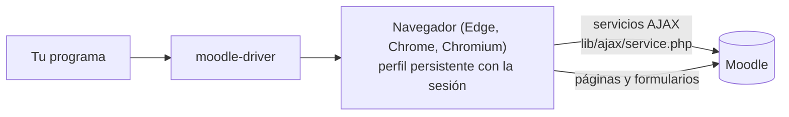

# Cómo funciona

El driver hace en Moodle lo que hace el navegador de la persona cuando usa el sitio: carga las páginas de Moodle con su sesión y, desde esas páginas, llama a los servicios a los que llama el propio JavaScript de Moodle. Saber cómo te permite prever cuánto cuesta una llamada, qué registra Moodle y por qué funciona en cualquier idioma de la interfaz.

**Términos:** [servicio AJAX](../reference/glossary.md#ajax-service), [sesskey](../reference/glossary.md#sesskey), [pestaña de trabajo](../reference/glossary.md#working-tab).

## Un navegador, muchas pestañas {#one-browser-many-tabs}

`createBrowserManager` es dueño de un único contexto de navegador persistente sobre el perfil. Las funciones toman ese contexto y, para cada tarea, abren una pestaña, hacen lo que necesitan y la cierran. El navegador arranca con la primera llamada y sigue abierto hasta `close()`. Solo ocurre un lanzamiento o relanzamiento cada vez, porque dos navegadores no pueden compartir un perfil.

## Primero los servicios, las páginas donde ningún servicio sirve {#services-first-pages-where-no-service-helps}

Las páginas de Moodle llaman a servicios AJAX (`lib/ajax/service.php`) para la mayor parte de lo que muestran: el estado del curso, los mensajes de un foro, un panel de calificación, una tabla de participantes. Esos servicios responden JSON, son estables entre temas e idiomas, y comprueban los permisos como lo haría la página. El driver los llama como la página, con la sesión de la persona y su `sesskey`, pero sin pestaña: una petición HTTP que lleva las cookies del perfil (`service.php` no necesita nada que añada un navegador). Lee la `sesskey` una vez de una página ligera (las preferencias de la persona) y la guarda; cuando Moodle dice que está caducada (un nuevo inicio de sesión, una sesión expirada), la vuelve a leer una vez antes de rendirse con `NotLoggedInError`. Las páginas y los formularios se abren en pestañas: medido, leerlas sin pestaña gana poco, porque la mayor parte del tiempo se la lleva el servidor de Moodle (ADR-011).

Muchas cosas no tienen ningún servicio AJAX abierto al navegador, o solo tienen uno para la app móvil: hacer la entrega de una tarea, publicar en un foro, un intento de cuestionario, la configuración de una actividad, una consulta. Para ellas el driver carga la página y la lee, o rellena y envía el mismo formulario que enviaría la persona, con la misma validación y los mismos mensajes. Donde Moodle genera un formulario dentro de la página a partir de un servicio (formularios dinámicos, fragmentos), el driver lo pide, lo rellena en una pestaña en blanco y lo devuelve serializado, como hace la ventana modal de la página.

## Leer por estructura, nunca por texto {#read-by-structure-never-by-text}

Los sitios Moodle funcionan en muchos idiomas, y los temas cambian los textos. El driver nunca compara textos visibles. Lee:

- ids y atributos de datos (`data-itemid`, `data-region`, `data-cmid`…),
- nombres de campos de formulario (`grade`, `answer`, `advancedgrading[criteria][1][levelid]`…),
- ids del body, que nombran la página en cualquier idioma (`page-mod-quiz-view`),
- URL y sus parámetros (`/mod/assign/view.php?id=35`, `slot=3`),
- nombres de archivo de iconos y clases CSS que codifican un estado (`completion-auto-y`, `qtype_multichoice`, `correct`).

Los textos se devuelven tal cual, en el idioma del sitio (una fecha como la muestra Moodle, un estado), solo donde no hay nada legible por una máquina.

## Qué ve Moodle {#what-moodle-sees}

El driver es la persona, en su navegador. Moodle registra las visitas a páginas y las acciones como de la persona, la finalización sigue lo que ve o hace, y las notificaciones salen como si hubiera hecho clic. Eso es lo que permite al driver funcionar sin permisos especiales, y también la razón de que un programa de estudiante pueda elegir un [ritmo](student-pace.md): leer todas las páginas a la vez no se parece a una persona en los registros de Moodle.

## Qué no hace nunca {#what-it-never-does}

- Escribir, guardar o pedir una contraseña: la persona inicia sesión a mano (ADR-002).
- Imprimir nada: la salida estándar de un programa puede ser un protocolo (la de un servidor MCP lo es).
- Leer variables de entorno o argumentos propios: todo le llega como opciones del programa.
- Saber de sus consumidores: nada de MCP, ni de agentes, ni nombres de herramientas (ADR-006).

## Decisiones de diseño {#design-decisions}

Las decisiones que hay detrás del diseño están registradas como ADR en [`.minispec/decisions`](https://github.com/falkenslab/moodle-driver/tree/main/.minispec/decisions) del repositorio: el navegador del sistema y el Chromium de Playwright (ADR-001), iniciar sesión a mano en un perfil persistente (ADR-002), las cookies de sesión guardadas en el perfil (ADR-003), los servicios AJAX a través de la página (ADR-004), el rastro configurable (ADR-005), una biblioteca para cualquier programa (ADR-006), el navegador visible bajo demanda y la pestaña de trabajo (ADR-007), inglés en todas partes (ADR-008).
